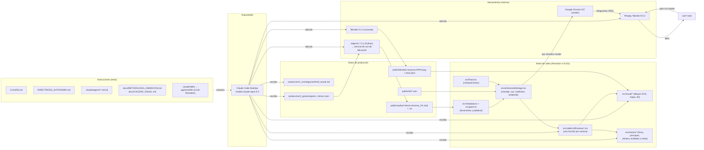
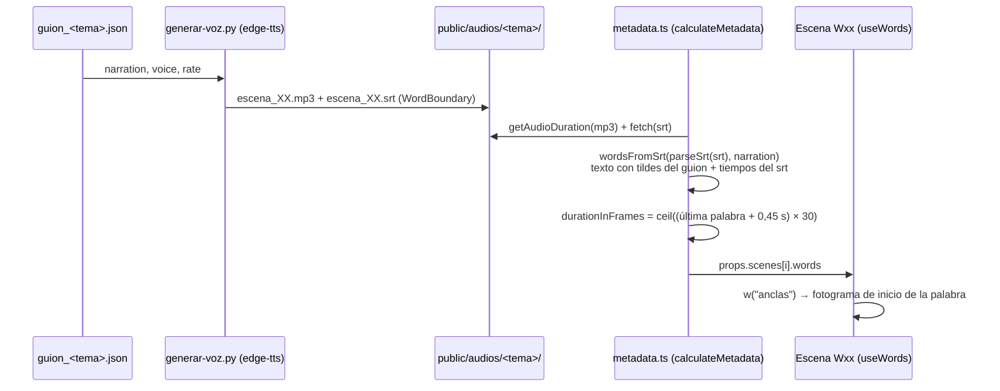
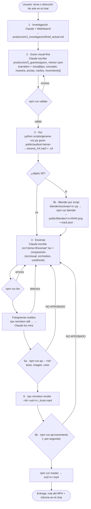
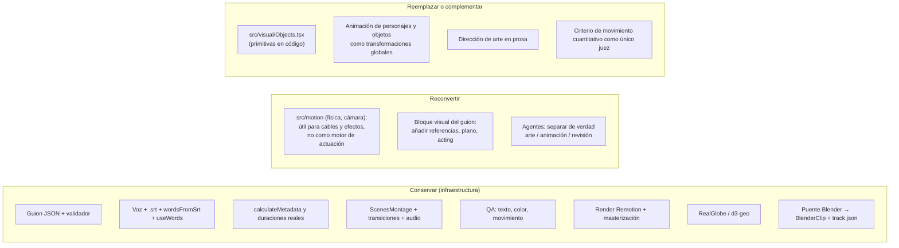

# Auditoría técnica integral del sistema de generación de videos

- **Fecha:** 2026-11-08
- **Proyecto:** `C:\Users\djsan\EstudioIA_Videos\motor-video` (repositorio git, rama `master`, un único commit `4bd25c7`; todo lo posterior está sin commitear).
- **Destinatario:** una IA especialista en producción audiovisual, animación y dirección artística que debe proponer una transformación de la metodología.
- **Alcance:** estado del sistema tal como está hoy, sin modificar nada. Esta auditoría no cambió código, dependencias ni configuración; sólo añadió este documento.

### Método y nivel de verificación

Todo lo que aparece aquí se comprobó con una de estas fuentes, que se indican cuando importa:

| Fuente | Qué se comprobó |
| --- | --- |
| Código fuente y configuración | Lectura directa de `src/`, `scripts/`, `blender/`, `.claude/`, `docs/`, `package.json`, `remotion.config.ts`, `skills-lock.json` |
| Medición sobre el código | Recuento de primitivas SVG, de usos de cada herramienta de movimiento y de literales numéricos (comandos de PowerShell sobre los archivos) |
| Entorno | Versiones obtenidas ejecutando cada herramienta (`node --version`, `ffmpeg -version`, `blender --version`…) |
| Historial de sesiones | Los dos registros de Claude Code de este proyecto (`~/.claude/projects/…/*.jsonl`): qué herramientas, agentes, skills y modelos se invocaron realmente |
| Videos renderizados | `ffprobe` sobre `out/*.mp4` y los informes de QA de `produccion/qa/` |

**Lo que no se pudo inspeccionar** se marca como tal en cada apartado. En particular:
- El servicio de voz de Microsoft que usa `edge-tts` es remoto; sólo se conoce su interfaz.
- Las sesiones de chat anteriores a los dos registros existentes no están disponibles.
- No hay evaluación humana de los videos: las métricas miden cantidad de movimiento, texto y color, no belleza ni expresividad.

---

## 1. Resumen ejecutivo

1. **Qué es el sistema.** Una aplicación de Remotion (React + TypeScript) en la que **cada fotograma de cada video es código escrito a mano** por Claude Code (modelo `claude-opus-5-5`). No hay archivos de ilustración, ni animación hecha en un editor, ni personajes. Las imágenes son componentes React que dibujan SVG con coordenadas literales; el movimiento son funciones matemáticas del número de fotograma.
2. **Cadena de producción:**
   - **Guion:** JSON con un bloque `visual` por escena.
   - **Voz:** `edge-tts`, voz neuronal de Microsoft `es-MX-JorgeNeural`, con un `.srt` por palabra.
   - **Escenas:** componentes `.tsx` que leen el momento de cada palabra.
   - **Render:** Chrome renderiza fotograma a fotograma y ffmpeg codifica el MP4.
   - **Control de calidad:** scripts propios que miden texto, color y cantidad de movimiento.
3. **Hallazgo central sobre la estética.** La biblioteca de objetos (`src/visual/Objects.tsx`) son 14 objetos hechos con 65 primitivas SVG escritas a mano (21 `rect`, 22 `path`, 16 `line`, 5 `circle`, 1 `ellipse`) y 584 números literales. Un teléfono, por ejemplo, son tres rectángulos, un trazado, dos líneas y un círculo. No existe dibujo de autor, ni variación de línea dibujada por una mano, ni volumen, ni articulaciones, ni personajes.
4. **Hallazgo central sobre la animación.** Los objetos se mueven como bloques rígidos: se trasladan, giran o escalan enteros (un `transform` sobre un `<g>`). Hay un buen sistema de física y cámara (cuerdas Verlet, caídas con gravedad, cámara con inercia y paralaje), pero se aplica a formas que no pueden deformarse ni actuar. La vida que hay es la del objeto empujado por fuerzas, no la de un objeto animado.
5. **Hallazgo central sobre la organización.**
   - **Los cuatro agentes de `.claude/agents/` nunca se han invocado** según los registros, y de las 13 skills de Remotion sólo se cargó una vez una (`remotion-best-practices`). Toda la producción la hizo directamente el agente principal, sesión a sesión, a partir de las instrucciones de `CLAUDE.md`.
   - **No hay ninguna herramienta de IA generativa de imagen o video.**
   - **No hay ningún director de arte humano en el circuito.**
6. **Qué conservar y qué cambiar (preliminar):**
   - **Infraestructura que se puede conservar:** voz y sincronización por palabra, metadatos y montaje en Remotion, transiciones, control de calidad y render.
   - **Capa que habría que sustituir o complementar:** cómo se crean los dibujos y cómo actúan; hoy, primitivas SVG en código. Las alternativas son ilustración de autor en vectores o mapas de bits, *rigging* 2D (Rive, Spine, Moho, Live2D), Lottie desde After Effects o Grease Pencil de Blender, o modelos 3D con cel shading. Remotion ya tiene vías de integración para Lottie y Rive (`@remotion/lottie`, `@remotion/rive`, según `.agents/skills/remotion-markup/`).

---

## 2. Arquitectura general



Principio de funcionamiento: **un video es una función pura `fotograma → imagen`.** Remotion monta el árbol React para cada número de fotograma, Chrome lo pinta y se captura. No hay línea de tiempo con fotogramas clave editables, ni capas de un editor: todo momento, posición, color y curva está escrito en TypeScript.

---

## 3. Inventario de herramientas, recursos y configuración

### 3.1 Entorno de ejecución (comprobado ejecutando cada herramienta)

| Elemento | Versión / dato | Uso |
| --- | --- | --- |
| Windows 11 Pro | 10.0.26200 | Sistema operativo |
| GPU | NVIDIA GeForce RTX 5050 Laptop (8 GB) + Intel UHD | Blender (EEVEE) y WebGL en Chrome |
| RAM | 24 GB | — |
| Node.js / npm | v22.23.4 / 10.9.9 | Remotion, scripts `.mjs` |
| Python | 3.12.10 | `scripts/generar-voz.py` |
| edge-tts | 7.3.1 | Síntesis de voz |
| ffmpeg / ffprobe | 9.0.2 (build gyan.dev) | Medición de audio, QA, masterización, composición de hojas |
| Google Chrome | 157.0.8103.38 | Navegador de render de Remotion (`remotion.config.ts`) |
| Blender | 5.2.3 LTS | Render 3D por script (instalado el 2026-11-08) |
| yt-dlp | 2026.10.26 | Instalado; **no consta su uso** en los registros |

### 3.2 Modelos de inteligencia artificial

| Modelo | Dónde | Función | Verificación |
| --- | --- | --- | --- |
| `claude-opus-5-5` (Claude Code Desktop) | Sesión principal | Investiga, escribe guion, escribe **todo** el código de escenas e ilustraciones, ejecuta herramientas, revisa fotogramas | Campo `model` en ambos registros |
| `claude-sonnet-5-5` | Aparece en el registro de la sesión principal | No se pudo determinar qué paso lo usó (no hay subagentes invocados; probablemente una tarea auxiliar del propio cliente) | Campo `model` en el registro |
| `es-MX-JorgeNeural` (Microsoft, vía `edge-tts`) | `scripts/generar-voz.py` | Locución en español con marcas de tiempo por palabra | Guion (`"voice"`) y script |
| Generación de imagen / video | — | **No se usa ninguno.** No hay Stable Diffusion, Flux, Runway, Wan, LTX ni similares instalados o configurados | Búsqueda en dependencias, scripts y registros |

### 3.3 Agentes de IA (`.claude/agents/`)

Los cuatro archivos son instrucciones en Markdown con *frontmatter*. No declaran un modelo propio, así que heredarían el de la sesión.

| Agente | Archivo | Función declarada | Entrada → salida declarada | ¿Usado? |
| --- | --- | --- | --- | --- |
| `researcher-factchecker` | `.claude/agents/researcher-factchecker.md` (18 líneas) | Investigar con búsqueda web o `yt-dlp`, cruzar ≥ 2 fuentes, listar referencias visuales | Tema → `produccion/1_investigacion/brief_actual.md` | **No.** 0 invocaciones |
| `retention-scriptwriter` | `.claude/agents/retention-scriptwriter.md` (50 líneas) | Guion visual-first en JSON, validado con `npm run validar` | Brief → `produccion/2_guiones/guion_<tema>.json` | **No.** 0 invocaciones |
| `remotion-animator` | `.claude/agents/remotion-animator.md` (41 líneas) | Convertir cada bloque `visual` en una escena de Remotion con `src/visual/` y `src/motion/`; QA obligatorio | Guion + audios → `src/<tema>/*.tsx`, `out/*.mp4` | **No.** 0 invocaciones |
| `seo-packaging` | `.claude/agents/seo-packaging.md` (11 líneas) | Títulos, descripciones y miniaturas `<Still>` | — | **No.** 0 invocaciones; no existe ninguna miniatura en el proyecto |

Verificación: se extrajeron todas las llamadas `tool_use` de nombre `Agent`, `Task` o `Skill` de los dos registros. Resultado: ninguna llamada a `Agent` o `Task`, y una sola a `Skill` (`remotion-best-practices`, 2026-11-08 15:11 UTC, primera sesión). Las versiones anteriores de los agentes se guardaron en `docs/historial/agents/`.

**Implicación:** los agentes son documentación, no un sistema multiagente en funcionamiento. La «especialización» actual consiste en que el mismo modelo lee instrucciones distintas.

### 3.4 Skills

- **Ubicación:** `.claude/skills` es un **enlace simbólico** a `.agents/skills/`. El origen, según `skills-lock.json`, es el repositorio de GitHub `remotion-dev/skills`, con un hash por skill.
- **Instaladas (13):** `remotion-best-practices` (índice), `remotion-captions`, `remotion-create`, `remotion-docs`, `remotion-interactivity`, `remotion-license`, `remotion-maps`, `remotion-markup` (efectos, transiciones, 3D, Lottie, audio, *timing*…), `remotion-multimedia`, `remotion-render`, `remotion-saas`, `remotion-studio` y `remotion-upgrade`.
- **Usadas:** `remotion-best-practices`, una vez. El resto del conocimiento de Remotion se aplicó desde el propio modelo.
- **Contenido relevante para el futuro que no se ha usado:**
  - `remotion-markup/lottie.md` (`@remotion/lottie`);
  - la mención a `@remotion/rive` en `remotion-markup/effects.md` y `cropping.md`;
  - `motion-blur.md`, `light-leaks.md`, `color-correction.md`, `embedding-videos.md`.
- **No hay ninguna skill propia del estudio.** El procedimiento vive en `CLAUDE.md`, los agentes y `docs/`. Se descartó crear una dentro de `.claude/skills` porque es un enlace a las skills de Remotion y podría sobrescribirse al actualizarlas (`docs/INFORME_AUDITORIA_VISUAL.md`, §6).

### 3.5 Servidores MCP y conectores

- **Configuración del proyecto:** no hay `.mcp.json`, `.claude/settings.json` ni `.claude/settings.local.json`.
- **Disponibles en la sesión de Claude Code Desktop** (por la cuenta o la aplicación, no por el proyecto):

  | Conector | ¿Usado en producción? | Uso real |
  | --- | --- | --- |
  | Navegador integrado (`mcp__Claude_Browser__*`) | Sí, puntual | Abrir Remotion Studio (`.claude/launch.json`, puerto 3000) y leer la consola en las primeras sesiones |
  | Turnos de la app (`mcp__ccd_turn__*`) | Sí | Lista de tareas y resumen; no afecta al video |
  | Claude in Chrome, Canva, editor de documentos, pizarras, registro MCP, tareas programadas, terminal, visualización | No | — |
  | Plugins sin autorizar (Figma, GitHub, Notion, Slack, Ahrefs…) | No | Requieren autorización; ninguno interviene |

- **Conclusión:** el pipeline **no depende de ningún MCP**. Blender se integró por línea de comandos; `blender-mcp` no está instalado.

### 3.6 Aplicaciones y servicios externos

| Aplicación | Función | Acceso | Entrada → salida | Interactúa con | Carácter | Limitaciones |
| --- | --- | --- | --- | --- | --- | --- |
| Remotion 4.0.541 (CLI y Studio) | Compositor, línea de tiempo y render | `npx remotion render/still/studio`; `src/index.ts` → `src/Root.tsx` | Árbol React → fotogramas → MP4 (H.264) | Chrome, ffmpeg (incluido en Remotion), `public/` | Indispensable (núcleo) | Sin editor visual de fotogramas clave. La licencia es gratuita para particulares y empresas pequeñas, de pago para empresas mayores (ver `remotion-license`) |
| Google Chrome | Pinta cada fotograma (DOM, SVG, WebGL) | `Config.setBrowserExecutable(...)` en `remotion.config.ts`, porque la descarga automática falló por red | — | Remotion | Reemplazable (otro Chromium) | Rendimiento de los filtros SVG |
| edge-tts → servicio de voz de Microsoft | Locución neuronal y marcas por palabra | `python scripts/generar-voz.py <guion> <carpeta>` | Narración y voz → `.mp3` + `.srt` | Remotion (`metadata.ts`) | Reemplazable (cualquier TTS con marcas de tiempo) | Servicio no oficial y gratuito; a veces se cuelga (el script reintenta 4 veces con 40 s de límite); voz poco expresiva; no se controla la entonación |
| ffmpeg / ffprobe | Duraciones, detección de silencios, QA de movimiento, hojas de contactos, masterización (`alimiter`) y efectos de sonido sintetizados | Desde los scripts `.mjs` | Audio y video → métricas, `.wav`, `.mp4` | Todos los scripts | Indispensable | — |
| Blender 5.2.3 | Objetos 3D con cel shading y tinta Freestyle, en PNG transparente | `npm run blender -- <escena>` → `scripts/blender-render.mjs` | Script Python → `public/blender/<escena>/####.png` + `track.json` | `BlenderClip` en Remotion | Opcional | Todo el modelado es por código (cajas y perfiles extruidos); Freestyle ignora los materiales *holdout*; un único objeto hecho (buque) |
| yt-dlp | Investigar a la competencia (según `CLAUDE.md`) | CLI | — | — | Opcional | No consta su uso |

### 3.7 Librerías del proyecto (`package.json`)

| Paquete | Versión | Función | ¿Importado en `src/`? |
| --- | --- | --- | --- |
| `remotion`, `@remotion/cli` | 4.0.541 | Núcleo y CLI | Sí |
| `@remotion/transitions` | ^4.0.541 | `TransitionSeries` | Sí (`ui/ScenesMontage.tsx`, `ui/Transitions.tsx`) |
| `@remotion/media` | 4.0.541 | `<Audio>` | Sí (`ui/SceneShell.tsx`, `ui/ScenesMontage.tsx`, `ui/Sfx.tsx`) |
| `mediabunny` | 1.64.0 | Duración real del mp3 | Sí (`src/get-audio-duration.ts`) |
| `@remotion/google-fonts` | ^4.0.541 | Space Grotesk, Playfair Display, JetBrains Mono | Sí (`src/theme.ts`) |
| `three`, `@react-three/fiber`, `@remotion/three` | 0.187.0 / 9.8.2 / 4.0.541 | 3D en el navegador | Sí (`visual/Cable3D.tsx`) |
| `d3-geo`, `topojson-client`, `world-atlas` | 3.1.2 / 3.1.0 / 2.0.2 | Proyección ortográfica y costas de Natural Earth 1:50m | Sí (`visual/RealGlobe.tsx`) |
| `roughjs` | 4.6.6 | Trazo «a mano» | Sí (`motion/hand.tsx`); `RoughPath` sólo se usa en `PruebaTecnica` |
| `perfect-freehand` | 1.2.3 | Pinceladas de grosor variable | Sí (`motion/hand.tsx` → `InkStroke`) |
| `@remotion/motion-blur`, `@remotion/paths`, `@remotion/captions`, `@remotion/media-utils` | 4.0.541 | Desenfoque de movimiento, utilidades de trazados, subtítulos | **No** (instalados, sin usar) |
| `lucide-react` | ^1.70.0 | Iconos | **No** (se usó en el primer video; hoy está prohibido por `CLAUDE.md`) |
| Desarrollo: `@remotion/bundler`, `@remotion/renderer` | 4.0.541 | Render programático para el QA | Sí (`scripts/qa-visual.mjs`) |
| Desarrollo: `eslint`, `@remotion/eslint-config-flat`, `typescript`, `prettier`, `@types/*` | — | `npm run lint` = `eslint src && tsc` | Sí |

### 3.8 Scripts de automatización (`package.json` → `scripts`)

| Comando | Archivo | Entrada | Salida | Función |
| --- | --- | --- | --- | --- |
| `npm run validar -- <guion>` | `scripts/validar-guion.mjs` (63 líneas) | Guion JSON | Código 0/1 y lista de errores | Exige en cada escena `visual.tipo` (lista cerrada), `concepto`, `muestra` (≥ 30 caracteres), `movimiento` (≥ 40), ≥ 2 `anclas` que existan en la narración y ≤ 3 `rotulos` de ≤ 3 palabras; prohíbe palabras como «icono», «dashboard» o «tarjeta» |
| `python scripts/generar-voz.py <guion> <dir> [--force]` | `scripts/generar-voz.py` (59) | Guion JSON (`voice`, `rate`, `narration`) | `escena_XX.mp3` + `escena_XX.srt` | edge-tts con `boundary="WordBoundary"`, reintentos y límite de tiempo |
| `npm run blender -- <escena> [--frames --width --height --still --track-only --orbit …]` | `scripts/blender-render.mjs` (49) → `blender/escenas/<escena>.py` | Script de escena | PNG con alfa + `track.json` | Lanza `blender -b --factory-startup -P …` |
| `npm run qa -- <IdComposición> [--every=2] [--out=…]` | `scripts/qa-visual.mjs` (179) | Composición | `informe.md`, `metricas.json`, `hoja_contactos.jpg` | Renderiza cada 2 s con y sin texto (`qaHideText`) y mide texto %, imagen %, colorido de Hasler-Süsstrunk y la relación imagen/texto |
| `npm run qa:movimiento -- <mp4> [--por-segundo]` | `scripts/qa-movimiento.mjs` (61) | MP4 | Tabla y veredicto | Diferencia entre fotogramas a 270x480 (umbral 14/255): congelados < 0,5 %, «fijo + detalle» < 3 % |
| `npm run master -- <in> <out>` | `scripts/masterizar.mjs` (14) | MP4 | MP4 | `alimiter` 0,89 sobre el audio; el video se copia sin recodificar |
| `npm run sync` | `scripts/sincronizar-audios.mjs` (128) | `guion_actual.json` | `public/audios/sincronia.json` | **Obsoleto.** Sincronizaba el primer video por detección de silencios; los videos verticales usan el `.srt` |
| `npm run lint` | — | `src/` | — | ESLint + `tsc` |
| `npm run dev` | — | — | Remotion Studio | Vista previa interactiva |

### 3.9 Recursos

| Recurso | Ruta | Origen | Uso actual |
| --- | --- | --- | --- |
| Locuciones del video vertical | `public/audios/cable_submarino/escena_01…12.mp3/.srt` | edge-tts, `rate +12 %` | Video del cable (v1 a v4) |
| Locuciones del primer video | `public/audios/escena_01…04.*`, `sincronia.json` | edge-tts | `VideoUno` (horizontal) |
| Efectos de sonido | `public/sfx/click.wav`, `whoosh.wav`, `tick.wav`, `alert.wav` | Proporcionados por el usuario | Todas las versiones |
| Efectos sintetizados | `public/sfx/ambiente_oceano.wav` (14 MB), `chapoteo.wav`, `retumbo.wav` | Generados con filtros de ffmpeg (ruido filtrado) | v3 y v4 |
| Fotografías | `public/assets/creditcard.jpg`, `datacenter.jpg`, `submarines_cable.jpg`, `wallstreet.jpg` | Presentes en el proyecto desde el inicio; genéricas y monocromas | Sólo `VideoUno` y el primer video del cable; `CLAUDE.md` prohíbe usarlas como recurso principal |
| Secuencias 3D | `public/blender/buque_portacontenedores/` (180 PNG, 45 MB), `public/blender/buque_w10/` (240 PNG) | Blender | `PruebaBlender`, `CableSubmarinoV4` (escena 10) |
| Datos geográficos | `node_modules/world-atlas/land-50m.json` | Natural Earth (dominio público) | `RealGlobe` |

### 3.10 Configuración, plantillas y presets

| Archivo | Contenido relevante |
| --- | --- |
| `remotion.config.ts` | Fotogramas intermedios en JPEG, sobrescribir salida, Chrome del sistema |
| `tsconfig.json`, `eslint.config.mjs`, `.prettierrc` | Estándar de la plantilla de Remotion |
| `.claude/launch.json` | Configuración `remotion-studio` (`npx remotion studio --no-open --port=3000`) |
| `src/visual/palette.ts` | Paleta `ATLAS` (24 colores con significado), `OUTLINE = 4`, `SVG_SHADOW = drop-shadow(8px 8px 0 #111)` |
| `src/theme.ts` | Paleta editorial anterior (`COLORS`), fuentes, `EASE_OUT`, `EASE_IN_OUT` y `CLAMP` |
| `src/ui/Captions.tsx` | `CAPTIONS_VERTICAL = { bottom: 430, side: 70, fontSize: 66 }` |
| `src/ui/ScenesMontage.tsx` | `TRANSITION_FRAMES = 9`, ambiente a volumen 0,28 |
| `blender/lib/atlas.py` | Copia de la paleta en Python, material toon de 3 tonos, tinta Freestyle de 4 px, sol, gestión de color «Standard» |
| Presets de composición | Todas las verticales son 1080x1920 a 30 fps; las horizontales (`VideoUno`), 1280x720 |

### 3.11 Prompts e instrucciones en cada etapa

No hay plantillas de prompt parametrizadas. El comportamiento lo guían estos textos, que el modelo lee como contexto:

| Texto | Etapa | Qué impone |
| --- | --- | --- |
| `CLAUDE.md` (89 líneas; se carga siempre) | Todas | Nicho, formato 9:16 de 65-75 s, principio «la narración explica; la imagen demuestra», identidad «Atlas Técnico», color con significado, límites de texto, método de animación, flujo obligatorio, «reglas de oro» (cero alucinaciones, sincronización al milisegundo, modularidad) |
| `DIRECTRICES_AUTONOMIA.md` (29) | Libertad creativa | Objetivo comercial (AdSense, alto RPM), referencias de estilo (Vox, PolyMatter, Johnny Harris), ciclo de 5 fases |
| `.claude/agents/*.md` | Teóricamente por etapa | Ver §3.3 (no se han invocado) |
| `docs/METODOLOGIA_ANIMACION.md` (101) | Animación | Animatic intencional (qué aparece, cómo se mueve, cómo interactúa, qué explica, cuándo), gramática de movimiento, uso de Blender |
| `docs/CALIDAD_VISUAL.md` (68) | QA | Umbrales numéricos y lista de revisión humana |
| Bloque `visual` de cada escena del guion | Escena | Es, en la práctica, el **prompt de cada escena**: `tipo`, `concepto`, `muestra`, `anclas`, `rotulos`, `movimiento` (ejemplo en §5.2) |
| Mensajes del usuario en el chat | Cada iteración | Las grandes direcciones de arte llegaron así: «Dark Tech UI», «Editorial Tactile Documentary», «Atlas Técnico», rediseño de la animación, Blender. Historial en `docs/historial/` |

### 3.12 Instalado, usado y disponible

| Categoría | Instalado o configurado | Usado de verdad en la producción | Sólo disponible |
| --- | --- | --- | --- |
| Modelo de lenguaje | — | `claude-opus-5-5` | — |
| Agentes | 4 en `.claude/agents/` | Ninguno | Los 4 y los genéricos de Claude Code |
| Skills | 13 de Remotion | `remotion-best-practices` (1 vez) | 12 |
| MCP | Ninguno en el proyecto | Navegador integrado (vista previa) | Canva, documentos, pizarras, Chrome… |
| Voz | edge-tts | Sí | — |
| Imagen o video generativo | Ninguno | — | — |
| 3D | three.js, Blender | Ambos (`Cable3D` en v3; buque de Blender en v4) | — |
| Animación 2D profesional (rig, Lottie, Rive) | Ninguna | — | Vía `@remotion/lottie` o `@remotion/rive`, no instalados |
| Edición o posproducción | ffmpeg | Masterización de audio | — |
| Librerías npm sin uso | `@remotion/motion-blur`, `@remotion/paths`, `@remotion/captions`, `@remotion/media-utils`, `lucide-react` | — | — |

---

## 4. Análisis técnico del sistema de animación

### 4.1 Modelo de render: todo es función del fotograma

- **Cómo se calcula cada fotograma.** Cada componente llama a `useCurrentFrame()` y calcula su estado a partir de ese número. Remotion pide fotogramas en cualquier orden y en paralelo, así que **no puede haber estado acumulado** entre fotogramas.
- **Cómo se resuelven las simulaciones.** Las físicas (`src/motion/physics.ts`) se calculan desde el fotograma 0 y guardan el historial en una caché en memoria, con una clave por simulación. Pedir el fotograma N siempre devuelve lo mismo.
- **Qué no se puede usar.** Herramientas que dependen del tiempo real (GSAP, CSS animations, `requestAnimationFrame`).

### 4.2 Cómo se construyen los objetos y personajes

**No hay personajes.** Ninguno de los videos tiene figuras humanas ni animales con comportamiento; la ballena y los peces son siluetas que se trasladan.

Los objetos son componentes React que devuelven SVG con **primitivas geométricas y coordenadas literales**:

| Archivo | Componentes | `rect` | `path` | `line` | `circle` | `ellipse` | Literales numéricos |
| --- | --- | ---: | ---: | ---: | ---: | ---: | ---: |
| `src/visual/Objects.tsx` (542 líneas) | Cloud, Phone, Satellite, Anchor, Ship, Trawler, Bank, Chip, Globe, Hose, ServerRack, Fish, Packet, Whale | 21 | 22 | 16 | 5 | 1 | 584 |
| `src/visual/Ocean.tsx` | `Ocean` (cielo, 4 bandas, olas, rayos, fondo de arena, 3 rocas), `SeaCable` | 2 | 8 | 1 | 0 | 0 | — |
| `src/visual/CableCutaway.tsx` | Corte por capas, `MmRuler` | 2 | 5 | 2 | 0 | 2 | — |
| `src/visual/AtlanticMap.tsx` | Mapa esquemático (v2) | 1 | 2 | 2 | 0 | 0 | — |
| `src/visual/RealGlobe.tsx` | Globo con costas reales (d3-geo) | 0 | 5 | 0 | 4 | 0 | — |

(Recuento de etiquetas JSX en el código; las que están dentro de un `.map()` se repiten al renderizar.)

Ejemplo literal del teléfono (`src/visual/Objects.tsx`, líneas 59-109, resumido):

```tsx
export const Phone: React.FC<Place & { glow?: number }> = ({ glow = 0, ...p }) => (
  <G {...p}>
    <rect x={-85} y={-165} width={170} height={330} rx={26} fill={ATLAS.poly} {...ink} />
    <rect x={-70} y={-135} width={140} height={260} rx={10} fill={ATLAS.sea1} />
    <rect ... fill={ATLAS.amber} opacity={glow * 0.6} />           {/* «brillo» */}
    <path d="M -50 -95 h 90 a 12 12 0 0 1 12 12 v 34 ..." />       {/* burbuja */}
    <line x1={-34} y1={-70} x2={30} y2={-70} ... />               {/* «texto» */}
    <line x1={-34} y1={-56} x2={10} y2={-56} ... />
    <circle cx={0} cy={146} r={8} fill={ATLAS.steelDark} />        {/* botón */}
  </G>
);
```

- **Siluetas.** Se escriben a mano como cadenas `d` de SVG (por ejemplo, la nube son curvas Bézier con coordenadas fijas) o con rectángulos con esquinas redondeadas. No vienen de un dibujo, un escaneo ni una herramienta de ilustración.
- **Estilo.** Todo objeto lleva relleno plano, un contorno uniforme de 4 px (`OUTLINE`) y la misma sombra dura desplazada (`SVG_SHADOW`, aplicada por el contenedor `G`). Es un único grosor y una única sombra para todo, sin variación de línea, texturas ni luz.
- **Interfaz común (`Place`):** `x, y, s (escala), rot, opacity, shadow`. Es la única forma de mover un objeto.
- **Articulaciones.** **No existen.** No hay jerarquía de huesos, pivotes por pieza ni deformación de malla. Algunos objetos exponen un parámetro interno: `Phone.glow`, `Trawler.netDepth` (la red se alarga), `Fish.frame/n` (un banco que se desplaza) y `Whale.frame`, que mueve la cola con un seno.
- **Excepciones con más información visual:**
  - `RealGlobe`: costas reales de Natural Earth proyectadas con d3-geo.
  - `Cable3D`: three.js con tubos y cilindros, material toon de 3 tonos (`MeshToonMaterial`) y contorno por casco invertido.
  - Buque de Blender (`blender/escenas/buque_portacontenedores.py`): casco extruido desde un perfil de 7 puntos, 11 cajas (puente, chimenea, ventanas…), contenedores generados como cajas en una rejilla y humo con 7 icoesferas. También es geometría primitiva, aunque con volumen, sombreado de 3 tonos y tinta Freestyle.

### 4.3 Cómo se implementan las animaciones

Cada propiedad animada es una expresión que depende de `frame`. Hay cuatro familias de herramientas, en `src/motion/` y `src/cable/kit.tsx`:

| Familia | API | Implementación | Usos en las escenas v3 |
| --- | --- | --- | ---: |
| Interpolación con curva | `ease(frame, keys[], vals[])` (kit) | `interpolate` + `Easing.inOut(cubic)`, con fotogramas clave forzados a crecer | 30 |
| | `tween(frame, at, dur, curve)` (principles) | `interpolate` 0→1 con una de las curvas de `CURVES` | 33 |
| | `inAt(frame, at, dur)` (kit) | `interpolate` 0→1 con `EASE_OUT` | 9 |
| | `interpolate` directo | — | 3 |
| Principios clásicos | `settle` (muelle amortiguado) | Fórmula analítica | 28 |
| | `fall` (gravedad con rebotes) | Cinemática por tramos | 5 |
| | `squash` (estirar o aplastar según la velocidad) | Escala x/y | 2 |
| | `wobble` (oscilación amortiguada) | Seno con decaimiento exponencial | 3 |
| | `bob` (balanceo ocioso) | Seno + ruido | 21 |
| Física simulada | `rope` (Verlet) | Nodos, restricciones de distancia, suelo con fricción, fuerzas, rotura | 6 |
| | `follow` (muelle de seguimiento) | Sistema de muelle sobre un vector objetivo | 2 directos + todas las `DepthCamera` |
| Acabado | `BoilFilter`, `InkStroke`, `RoughPath` | `feTurbulence` + `feDisplacementMap` con semilla cada 3 fotogramas; perfect-freehand; roughjs | 14 / 10 / 0 |

Curvas disponibles (`src/motion/principles.ts`, `src/theme.ts`):

| Curva | Bézier | Uso previsto |
| --- | --- | --- |
| `CURVES.arrive` / `EASE_OUT` | (0.16, 1, 0.3, 1) | Llegadas |
| `CURVES.leave` | (0.7, 0, 0.84, 0) | Salidas |
| `CURVES.anticipate` | (0.6, -0.35, 0.4, 1) | Retroceso antes de moverse |
| `CURVES.overshoot` | (0.34, 1.56, 0.64, 1) | Sobrepaso |
| `CURVES.dolly` | (0.45, 0, 0.2, 1) | Cámara |
| `EASE_IN_OUT` | cubic in-out | `ease()` y todo v1 y v2 |

`spring()` de Remotion no se usa en ninguna escena v3: los muelles son propios.

**Qué significa en la práctica.** La animación consiste en **mover un `<g>` entero** con `translate/rotate/scale` o en recalcular unos pocos atributos (longitud de un trazado, opacidad, ancho de un rectángulo). Ejemplo real, la caída de la nube de la escena 1 (`src/cable/v3/EscenasA.tsx`, líneas 37-62):

```tsx
const c = fall(frame, dropAt, Y0, FLOOR - 80, { g, bounce: 0.15, bounces: 1 });
const prep = tween(frame, nube, dropAt - nube, CURVES.anticipate);   // anticipación
const st = squash(c.v, 0.006, 0.3);                                  // estirar según la velocidad
const land = wobble(frame, tLand, 0.22, 0.9, 0.12);                  // rebote al aterrizar
const sx = (frame < dropAt ? 1 + 0.06 * prep : st.sx) * (1 + land);
const sy = (frame < dropAt ? 1 - 0.1 * prep : st.sy) * (1 - land);
// … <Cloud x={540} y={cloudY} … /> se dibuja con scale(sx, sy)
```

Los principios de animación (anticipación, aplastar y estirar) se aplican como **escalado global** de una forma rígida: la nube se estrecha entera, no se deforma su contorno.

### 4.4 Cómo se generan las escenas

- **Una escena = un componente React** (`W01`…`W12` en `src/cable/v3/EscenasA|B|C.tsx`: 2343 líneas para 12 escenas, unas 195 por escena, con 1073 literales numéricos de dos o más cifras).
- **Plantilla de facto de cada escena:**

```text
1. frame = useCurrentFrame(); w = useWords(scene)
2. Anclas: const nube = w("nube"); const tirado = w("tirado") …   (fotogramas de palabras)
3. Constantes del mundo: SURF, FLOOR, posiciones (px) escritas a mano
4. Estados derivados: fall(), tween(), rope(), settle() … en función de frame y de las anclas
5. target(f) → [cx, cy, zoom] de la cámara por tramos de anclas
6. JSX:
   <Sfx …/> (efectos en fotogramas de anclas)
   <DepthCamera target=…>
     <Plane depth=1.2> fondo lejano </Plane>
     <Plane> <Stage w h> <BoilFilter/> <Ocean/> objetos… </Stage> Callouts </Plane>
     <Plane depth=-0.3 blur> partículas de primer plano </Plane>
   </DepthCamera>
   BigFigure / Odometer (cifra)
```

- **El «mundo».** Cada escena tiene un mundo SVG (`Stage`) más grande que la pantalla (por ejemplo, 1080x4200 en la escena 1 o 2600x2000 en la escena 10), y la cámara recorre ese lienzo.
- **Las escenas no comparten un modelo de escena.** No hay JSON de disposición ni editor: posiciones, tamaños y tiempos relativos están escritos en el código.

### 4.5 Cámara

- **v3 y v4: `DepthCamera`** (`src/motion/depth.tsx`):
  - el objetivo `target(f) → [cx, cy, zoom]` se define por tramos;
  - la cámara real lo **sigue con un muelle** (`follow`, `stiffness` entre 0,06 y 0,11, `damping` 0,74);
  - se suma ruido de cámara en mano (`handheld`, 3 a 7 px), temblor aleatorio en los impactos (`shake`) y una «respiración» del zum (±1,8 % sinusoidal + ruido).
- **Implementación.** Es un contexto de React. Cada `Plane` aplica `translate(...) scale(z)` a un `AbsoluteFill` con un factor de paralaje `f = 1/(1+depth)`. Es una cámara **2D afín**, sin perspectiva, rotación ni lente.
- **Versiones anteriores:** `src/ui/Camera.tsx`, un zum y paneo por fotogramas clave sin inercia (v2).

### 4.6 Profundidad

- **Planos de paralaje** (`Plane depth`): 23 en las escenas v3. Hay 3 en las escenas 1, 2 y 5; 2 en las escenas 3, 4 y 8-12; ninguno en la 6 (3D) y la 7 (globo). `CLAUDE.md` exige al menos 3 por escena, así que **sólo 3 de las 12 escenas cumplen**. Admiten desenfoque CSS opcional (`blur`) y bruma (`haze`).
- **Partículas** (`Drift`, 12 usos): «nieve marina» o polvo en primer plano desenfocado.
- **Profundidad dentro de cada plano:** es el orden de pintado del SVG; no hay oclusión 3D salvo en `Cable3D` y en los PNG de Blender.
- **Tamaño y luz.** Los objetos no cambian de escala con la distancia más allá de lo que se escribe a mano. No hay luz ni sombra proyectada entre objetos: la sombra es siempre el mismo desplazamiento de 8 px.

### 4.7 Sincronización con la narración



- **Tiempos.** El `.srt` de edge-tts 7.3.1 trae una palabra por bloque (comprobado en `escena_01.srt`: «Internet» 0,094-0,619 s, «no» 0,630-0,786 s…). El archivo está en UTF-8, y las tildes sólo se ven mal si se lee con otra codificación. Si un bloque tiene varias, el tiempo se reparte en proporción a su longitud (`src/guion.ts`, `wordsFromSrt`). Si el texto del `.srt` no coincide con el guion, el render falla con un error explícito.
- **Duración de cada escena.** Fin de la última palabra + 0,45 s; la última escena suma 1,8 s. Las transiciones solapan 9 fotogramas, que se restan en `overlapFrames`.
- **Anclas.** Cada cambio visual se ancla a una palabra (`useWords(scene)("palabra", n, "start"|"end")`). Son anclas de **inicio de acción**: la duración, la curva y la coreografía siguiente son números relativos al ancla, escritos a mano.

### 4.8 Transiciones y montaje

- **v3 y v4: `ScenesMontage`** (`src/ui/ScenesMontage.tsx`). Usa `TransitionSeries` con transiciones de 9 fotogramas (`linearTiming`) definidas en `src/ui/Transitions.tsx`:

  | Transición | Efecto | Escenas |
  | --- | --- | --- |
  | `iris(x, y)` | Recorte circular desde el objeto que conecta ambas escenas; la saliente se amplía y desenfoca | 02, 05, 06, 08, 12 |
  | `dive()` | La escena saliente sube y la nueva entra desde abajo | 04, 09 |
  | `rise()` | Lo contrario | 03, 11 |
  | `inkWipe()` | Mancha de tinta irregular que barre la pantalla | 07 |
  | Corte seco | Intencionado | 10 |

- **Capas comunes de cada escena** (`SceneShell`): fondo de papel o carbón, voz, *whoosh* al entrar, viñeta y subtítulos.
- **Capas del video entero:** grano (`Grain`) y ambiente oceánico en bucle a volumen 0,28.

### 4.9 Audio

| Capa | Origen | Control |
| --- | --- | --- |
| Voz | `escena_XX.mp3` | Una por escena, sin procesar |
| Efectos | `public/sfx/*.wav` con `<Sfx name at volume>` (44 apariciones en las escenas v3, incluidas importaciones) | Anclados a fotogramas de palabras o de eventos físicos (por ejemplo, el impacto calculado) |
| Ambiente | `ambiente_oceano.wav` sintetizado | Continuo, 0,28 |
| Masterización | `scripts/masterizar.mjs` | Limitador `alimiter` a 0,89 (pico final −1,2 dB, media −19,3 dB en v3 y v4) |

No hay música ni mezcla por escena: ni *ducking* ni ecualización.

### 4.10 Texto en pantalla

| Componente | Uso en v3 | Regla |
| --- | ---: | --- |
| `Captions` (`src/ui/Captions.tsx`) | Siempre | Bloques de 3-5 palabras del `.srt`, Space Grotesk 66 px, sin caja, palabra activa al 100 % y el resto al 40 % |
| `Callout` (`src/visual/stage.tsx`) | 39 apariciones en el código (incluidas importaciones) | Rótulo de ≤ 3 palabras, JetBrains Mono, caja con sombra dura |
| `BigFigure` / `Odometer` | 8 apariciones de `BigFigure` | Una cifra clave por escena |

### 4.11 Render final

```bash
npx remotion render CableSubmarinoV4 out/video_cable_submarino_v4_bruto.mp4
```

```bash
npm run master -- out/video_cable_submarino_v4_bruto.mp4 out/video_cable_submarino_v4.mp4
```

- **Proceso.** Remotion empaqueta el proyecto con su bundler y abre Chrome (el ejecutable de `remotion.config.ts`). Pinta cada fotograma, que guarda en JPEG, y codifica en H.264 con el ffmpeg integrado.
- **Resultado.** 1080x1920, 30 fps, 70,3 s (2107 fotogramas).
- **Tiempos:** el render de Remotion completo **no se cronometró** en esta auditoría. El de Blender se midió: 77-80 s para 180 fotogramas de 1080x720 y 105 s para 240.

### 4.12 Qué hace cada actor

| Parte | Quién o qué la produce | Cómo |
| --- | --- | --- |
| Investigación | Claude (`claude-opus-5-5`) | Búsqueda web en la sesión (12 llamadas a `WebSearch` en el registro principal); el brief actual tiene 4 datos y 3 fuentes generales sin URL |
| Guion y bloque `visual` | Claude | Escritura directa del JSON + `npm run validar` |
| Voz | Servicio de Microsoft vía edge-tts | Automático |
| Ilustraciones SVG | Claude, **escribiendo coordenadas en código** | Sin herramienta de dibujo; se revisa mirando fotogramas renderizados |
| Movimiento | Claude, escribiendo funciones de `frame` | Con la biblioteca `src/motion/` |
| 3D | Claude, escribiendo scripts (three.js o Python para Blender) | Render automático |
| Efectos de sonido sintetizados | Claude + filtros de ffmpeg | Automático |
| Control de calidad | Scripts propios + revisión de hojas de contactos por Claude | Automático + revisión visual del propio modelo |
| Decisiones de dirección de arte | El usuario, en el chat («Dark Tech», «Editorial Tactile», «Atlas Técnico»…), y Claude al aplicarlas | Sin *moodboard*, *style frames* ni guía de estilo visual con imágenes |
| Generación por IA de imagen o video | Nadie | No se usa |
| Animación con herramienta externa | Sólo Blender (un buque) | Por script |

---

## 5. Flujo de trabajo audiovisual

### 5.1 Diagrama del pipeline



### 5.2 Etapas en detalle

| # | Etapa | Componente | Herramienta / modelo | Entrada | Archivos generados o modificados | Instrucciones que rigen | Conexión con la siguiente |
| --- | --- | --- | --- | --- | --- | --- | --- |
| 1 | Investigación | Agente principal (en teoría `researcher-factchecker`) | `claude-opus-5-5`, WebSearch | Tema del usuario | `brief_actual.md` | `CLAUDE.md` (regla de oro 1), agente investigador | Datos y referencias visuales para el guion |
| 2 | Guion | Agente principal (en teoría `retention-scriptwriter`) | `claude-opus-5-5`, `validar-guion.mjs` | Brief | `guion_<tema>.json` | `CLAUDE.md`, agente guionista, validador | `narration` → voz; `visual` → escenas |
| 3 | Voz | `generar-voz.py` | edge-tts → `es-MX-JorgeNeural`, `rate +12 %` | Guion | `public/audios/<tema>/escena_XX.mp3/.srt` | Campos `voice` y `rate` del guion | `calculateMetadata` lee duración y palabras |
| 3b | 3D (opcional) | `blender-render.mjs` + `blender/escenas/*.py` | Blender 5.2.3, EEVEE + Freestyle | Script Python | PNG + `track.json` | `docs/METODOLOGIA_ANIMACION.md` («Objetos 3D con Blender») | `BlenderClip` + `trackPoint` en la escena |
| 4 | Escenas | Agente principal (en teoría `remotion-animator`) | `claude-opus-5-5` escribiendo TSX | Guion, audios, biblioteca | `src/<tema>/…/Escenas*.tsx`, composición, registro en `src/Root.tsx`; a veces nuevos componentes en `src/visual/` o `src/motion/` | `CLAUDE.md`, metodología, agente animador | Composición registrada → QA |
| 5a | QA estático | `qa-visual.mjs` | Remotion renderer + ffmpeg | Id de la composición | `produccion/qa/<carpeta>/<Id>/informe.md`, `metricas.json`, `hoja_contactos.jpg` | `docs/CALIDAD_VISUAL.md` | Si aprueba → render |
| 6 | Render | Remotion CLI | Chrome + ffmpeg | Id | `out/<x>_bruto.mp4` | — | MP4 → QA de movimiento |
| 5b | QA de movimiento | `qa-movimiento.mjs` | ffmpeg (`tblend`, `signalstats`) | MP4 | Tabla en consola | `docs/CALIDAD_VISUAL.md` §1b | Si aprueba → masterización |
| 7 | Masterización | `masterizar.mjs` | ffmpeg `alimiter` | MP4 | `out/<x>.mp4` | — | Entrega |
| — | Empaquetado SEO | (en teoría `seo-packaging`) | — | — | **Nunca se ha hecho** | — | — |

Ejemplo del «prompt» de una escena (bloque `visual` de la escena 1, `guion_cable_submarino.json`):

```json
{
  "tipo": "metáfora",
  "concepto": "La nube no existe: internet está en el fondo del mar.",
  "muestra": "Una nube ilustrada en el cielo se tacha con tinta roja; la cámara se hunde atravesando el océano hasta un cable que brilla tendido sobre la arena del fondo.",
  "anclas": ["nube", "tirado", "mar"],
  "rotulos": [],
  "movimiento": "La nube se tacha con tinta, se encoge (anticipación), cae con gravedad estirándose, chapotea al cruzar la superficie y se aplasta en el fondo; la cámara la persigue con inercia."
}
```

De ese texto a la imagen no hay ningún paso de diseño intermedio (ni boceto, ni *style frame*, ni *storyboard* dibujado, ni *animatic* con tiempos aprobados). El modelo lo traduce directamente a coordenadas y funciones en `W01`.

### 5.3 Historial de versiones (lo que se ha producido)

| Archivo | Composición | Dirección de arte | Formato | Duración | Tamaño |
| --- | --- | --- | --- | --- | --- |
| `out/primer_video.mp4` | `VideoUno` | «Dark Tech UI» (iconos de Lucide) | 1280x720 | 42 s | 10,7 MB |
| `out/primer_video_v2.mp4` | `VideoUno` | Dark Tech con cámara | 1280x720 | 36,5 s | 15,0 MB |
| `out/primer_video_v3.mp4` | `VideoUno` | «Editorial Tactile» (papel, fotos B/N, sellos) | 1280x720 | 36,5 s | 25,5 MB |
| `out/video_cable_submarino.mp4` | `CableSubmarino` | Editorial a color | 1080x1920 | 71,4 s | 97,2 MB |
| `out/video_cable_submarino_v2.mp4` | `CableSubmarinoV2` | «Atlas Técnico» (ilustración SVG) | 1080x1920 | 71,4 s | 39,2 MB |
| `out/video_cable_submarino_v3.mp4` | `CableSubmarinoV3` | Atlas + física, cámara multiplano, 3D, montaje | 1080x1920 | 70,3 s | 48,2 MB |
| `out/video_cable_submarino_v4.mp4` | `CableSubmarinoV4` | v3 + buque 3D de Blender en la escena 10 | 1080x1920 | 70,3 s | 62,9 MB |
| `out/prueba_blender.mp4` | `PruebaBlender` | Banco de pruebas de Blender | 1080x1920 | 6 s | 2,5 MB |

(Tamaños en MiB según `ffprobe` y el sistema de archivos.)

Métricas de calidad registradas (`docs/CALIDAD_VISUAL.md`):

| Versión | Texto medio | Imagen media | Colorido | Movimiento medio | Congelados | Fijo + detalle |
| --- | ---: | ---: | ---: | ---: | ---: | ---: |
| Cable v1 | 3,86 % | 7,4 % | 21,5 | 3,35 % | 22,3 % | 59,5 % |
| Cable v2 | 2,10 % | 67,1 % | 60,1 | 3,79 % | 11,8 % | 62,8 % |
| Cable v3 | 1,91 % | 62,6 % | 60,0 | 6,46 % | 2,5 % | 35,1 % |
| Cable v4 | 1,91 % | 62,7 % | 60,0 | 6,49 % | 2,5 % | 34,1 % |

Las hojas de contactos y comparativas están en `produccion/qa/` (`linea_base`, `iteracion_1`, `iteracion_2`, `final`, `v3`, `v4`, `comparativa_antes_despues.jpg`, `comparativa_v1_v2_v3.jpg`, `v4/comparativa_escena10_v3_v4.png`).

---

## 6. Problemas identificados y causas raíz

Cada problema indica: (1) en qué consiste, (2) qué componente lo provoca, (3) causa raíz, (4) limitaciones técnicas implicadas y (5) archivos o procesos relacionados.

### P1. Objetos construidos con figuras geométricas, sin identidad de dibujo
1. **En qué consiste:** cada objeto es un montaje de rectángulos, líneas, círculos y trazados simples con el mismo contorno y la misma sombra. Se lee como un «icono grande», no como una ilustración.
2. **Componente:** `src/visual/Objects.tsx`, `Ocean.tsx`, `CableCutaway.tsx`; también el buque de Blender (cajas).
3. **Causa raíz:** el único «ilustrador» del sistema es un modelo de lenguaje que escribe coordenadas sin ver mientras dibuja. Sólo comprueba el resultado después, renderizando. Lo más fiable para él son las primitivas y las curvas sencillas. No existe un paso de diseño visual con imágenes de referencia ni un artista.
4. **Limitaciones:** escribir trazados complejos a mano en texto es costoso y frágil; no hay herramienta de dibujo en el circuito ni recursos vectoriales de autor importables (SVG o Lottie); el estilo «relleno plano + 4 px + sombra 8 px» está impuesto globalmente (`palette.ts`, contenedor `G`).
5. **Relacionado:** `src/visual/*`, `src/visual/palette.ts`, `CLAUDE.md` («Identidad visual»), `blender/escenas/buque_portacontenedores.py`.

### P2. Ausencia total de personajes y de acción expresiva
1. **En qué consiste:** no hay personas, mascotas ni presentadores; los «actores» son objetos (nube, ancla, cable). Nada tiene intención, mirada ni gesto.
2. **Componente:** la biblioteca y el método de escena.
3. **Causa raíz:** no existe un sistema de personajes (diseño, poses, *rig*, expresiones, sincronía labial). Con primitivas y transformaciones globales no es viable construirlos.
4. **Limitaciones:** Remotion no ofrece *rigging*; sin `@remotion/lottie` ni `@remotion/rive` no hay forma de reproducir animación de personajes hecha en una herramienta especializada.
5. **Relacionado:** `src/visual/Objects.tsx`, `package.json`, `.agents/skills/remotion-markup/lottie.md`.

### P3. Movimiento de cuerpo rígido
1. **En qué consiste:** los objetos se trasladan, giran o escalan enteros. «Aplastar y estirar» es un escalado global; ninguna pieza se mueve respecto a otra (salvo en la ballena y la red). Las cuerdas sí se deforman, porque son simulaciones.
2. **Componente:** interfaz `Place`, contenedor `G`, `src/motion/principles.ts`.
3. **Causa raíz:** los objetos no tienen estructura interna animable (pivotes, huesos, piezas con nombre ni formas intermedias). La API sólo expone `x, y, s, rot, opacity`.
4. **Limitaciones:** deformar un trazado SVG requiere interpolar sus puntos (*morphing*), algo que el sistema no usa. `@remotion/paths` está instalado y sin usar.
5. **Relacionado:** `src/visual/Objects.tsx` (`G`, `Place`), `src/motion/principles.ts`.

### P4. Coreografía escrita como números, sin pasada de animación
1. **En qué consiste:** cada escena tiene unas 195 líneas con unos 90 literales numéricos que fijan posiciones, duraciones, rigideces y amplitudes. El *timing* se ajusta por prueba y error renderizando fotogramas sueltos.
2. **Componente:** `src/cable/v3/Escenas*.tsx`.
3. **Causa raíz:** no hay herramienta de animación con línea de tiempo, curvas editables y vista previa en tiempo real en el circuito. El autor (el modelo) no ve el movimiento: lo infiere de fotogramas sueltos y de una métrica de cantidad de movimiento.
4. **Limitaciones:** el modelo no reproduce video; la revisión «en movimiento» depende del usuario. `qa-movimiento` mide cuánto cambia la imagen, no si el *timing* es bueno.
5. **Relacionado:** `src/cable/v3/*`, `scripts/qa-movimiento.mjs`, `docs/CALIDAD_VISUAL.md` §2.8.

### P5. Movimiento «por cuota»: animación añadida para pasar la métrica
1. **En qué consiste:** tras introducir `qa:movimiento`, varias correcciones consistieron en añadir movimiento para bajar el porcentaje de fotogramas fijos: respiración de cámara, balanceos, partículas, aperturas con desplazamiento, barco que llega. Esto puede producir actividad sin intención.
2. **Componente:** `scripts/qa-movimiento.mjs` (umbral «fijo + detalle ≤ 40 %»), `DepthCamera` (respiración permanente), `Drift`, `bob`.
3. **Causa raíz:** el único criterio automático de animación es cuantitativo. No hay criterio de pausas intencionadas, claridad de la acción, legibilidad de la silueta ni puesta en escena.
4. **Limitaciones:** la calidad del movimiento no se puede medir de forma fiable con diferencias de píxeles.
5. **Relacionado:** `scripts/qa-movimiento.mjs`, `src/motion/depth.tsx` (líneas 66-70), `docs/INFORME_ANIMACION_V3.md` §5.

### P6. Estilo único repetido y sin evolución intencional
1. **En qué consiste:** todos los objetos comparten paleta, grosor, sombra, el mismo océano de 4 bandas y las mismas transiciones de 9 fotogramas. El componente `Ocean` (corte lateral de mar con fondo de arena) aparece en **10 de las 12 escenas** (todas salvo la 6 y la 7), así que escenas distintas se parecen mucho.
2. **Componente:** `Ocean`, `palette.ts`, `ScenesMontage`.
3. **Causa raíz:** la reutilización de componentes es la estrategia de productividad. Sin una biblia visual con variaciones (planos, escalas, texturas, iluminación por secuencia), reutilizar se convierte en repetir.
4. **Limitaciones:** generar variación de calidad en código cuesta tanto como dibujar algo nuevo.
5. **Relacionado:** `src/visual/Ocean.tsx`, `src/cable/v3/*`, `docs/METODOLOGIA_ANIMACION.md`.

### P7. Dirección de arte por reacción, no por diseño
1. **En qué consiste:** la estética ha cambiado cuatro veces en un día (Dark Tech → Editorial Tactile → Atlas Técnico → Atlas + física + 3D), siempre como respuesta a una crítica del resultado anterior.
2. **Componente:** el proceso (chat → código).
3. **Causa raíz:** no hay una fase previa de *look development*: referencias, paleta y tipografía probadas en *style frames*, prueba de personaje u objeto, prueba de movimiento aprobada. La dirección de arte se escribe en prosa (`CLAUDE.md`) y el modelo la traduce a código.
4. **Limitaciones:** la prosa no fija una estética con precisión; dos lecturas del mismo texto producen imágenes distintas.
5. **Relacionado:** `CLAUDE.md`, `docs/historial/`, `DIRECTRICES_AUTONOMIA.md`.

### P8. Escenas con lógica de diapositiva explicativa
1. **En qué consiste:** muchas escenas son «un objeto + una cifra grande + rótulos rojos» sobre un fondo esquemático (escena 10: «70 %», «ANCLAS», «REDES DE ARRASTRE», «TERREMOTOS»). Se entienden, pero se perciben como una infografía animada.
2. **Componente:** `BigFigure`, `Callout`, la estructura del bloque `visual` (`tipo: dato`, `rotulos`).
3. **Causa raíz:**
   - El formato del guion obliga a cada escena a demostrar un dato.
   - La puesta en escena se resuelve con un plano general esquemático y un lateral de corte técnico, sin planos de detalle, contraplanos ni puntos de vista de un protagonista.
   - La «cámara» es 2D y no puede cambiar de punto de vista.
4. **Limitaciones:** con la cámara afín y los mundos SVG planos, el lenguaje de planos queda reducido a zum y paneo.
5. **Relacionado:** `src/visual/stage.tsx`, `src/cable/v3/EscenasC.tsx` (`W10`), `scripts/validar-guion.mjs`.

### P9. Agentes y skills que no operan
1. **En qué consiste:** la arquitectura documentada (investigador → guionista → animador → SEO) no existe en la práctica: un único agente lo hace todo y no hay paquete de publicación.
2. **Componente:** `.claude/agents/`, `.claude/skills/`.
3. **Causa raíz:** los agentes no tienen un disparador (ni orquestación, ni comando, ni *hook*), y las peticiones del usuario se resolvían directamente en la sesión principal.
4. **Limitaciones:** el contexto de una sola sesión acumula decisiones; no hay revisión cruzada independiente.
5. **Relacionado:** `.claude/agents/*.md`, registros de sesión.

### P10. Voz sintética poco expresiva y sin diseño sonoro
1. **En qué consiste:** voz TTS gratuita con ritmo forzado (+12 %), sin música, con efectos genéricos (`whoosh`, `click`) y ambiente sintetizado con ruido filtrado.
2. **Componente:** `generar-voz.py`, `public/sfx/`, `masterizar.mjs`.
3. **Causa raíz:** se eligió una cadena gratuita y automática.
4. **Limitaciones:** edge-tts no permite controlar la entonación por palabra; no hay biblioteca de música ni efectos de calidad.
5. **Relacionado:** `scripts/generar-voz.py`, `public/sfx/`, `src/ui/ScenesMontage.tsx`.

### P11. Investigación débil como base visual
1. **En qué consiste:** el brief actual tiene 4 datos con 3 fuentes genéricas sin URL ni fecha, y no tiene referencias visuales (fotos reales del buque cablero, del cable, del puerto de Bilbao…).
2. **Componente:** `produccion/1_investigacion/brief_actual.md`.
3. **Causa raíz:** el brief es anterior a las reglas actuales del investigador y nunca se rehízo.
4. **Limitaciones:** sin referencias reales, los dibujos se basan en el conocimiento general del modelo (el barco «tipo», el teléfono «tipo»), lo que refuerza el aspecto genérico.
5. **Relacionado:** `brief_actual.md`, `.claude/agents/researcher-factchecker.md`.

### P12. Deuda estructural del código
1. **En qué consiste:**
   - Conviven cuatro generaciones de escenas (`src/escenas/`, `src/cable/`, `src/cable/v2/`, `src/cable/v3/`) y dos paletas (`theme.ts COLORS` y `palette.ts ATLAS`).
   - Hay dependencias sin uso y un script obsoleto (`sincronizar-audios.mjs`).
   - Los 45-60 MB de PNG de Blender están en `public/`.
   - Nada está commiteado desde el commit inicial.
2. **Componente:** el repositorio.
3. **Causa raíz:** iteración rápida conservando versiones anteriores (regla «los videos anteriores no se rompen»).
4. **Limitaciones:** el bundle de Remotion incluye todo `public/`. Sin commits no hay puntos de restauración.
5. **Relacionado:** `src/`, `package.json`, `public/blender/`, `git status` (24 entradas pendientes).

---

## 7. Limitaciones de la metodología actual

| Limitación | Consecuencia |
| --- | --- |
| La IA es a la vez ilustrador, animador, director de arte y revisor, y trabaja en texto | Calidad de dibujo acotada a lo que se puede escribir en coordenadas; no hay mirada externa |
| No hay ninguna herramienta de autoría visual (vectorial, 2D, *rigging*) en el circuito | Imposible obtener línea de autor, personajes o animación de piezas |
| Cámara 2D afín | Sin cambio de punto de vista, perspectiva ni lenguaje de planos |
| Revisión por fotogramas sueltos + métricas cuantitativas | El *timing*, el peso y la expresividad no se validan; el usuario es el único que ve el movimiento |
| Estilo fijado globalmente y en prosa | Repetición; la estética depende de la interpretación |
| Sin recursos de autor (ilustraciones, fotos reales a color, música) | Todo nace del modelo; tendencia a lo genérico |
| 3D por script con geometría primitiva | El 3D tiene volumen, pero hereda la simplicidad de formas |
| Cadena gratuita (edge-tts, efectos sintetizados) | Techo de calidad sonora |

Lo que **sí funciona** y conviene preservar:
- **Sincronía.** Por palabra, verificada contra el texto.
- **Determinismo del render.** Mismo resultado en cada render, con la física incluida.
- **Montaje automatizado.** Transiciones solapadas en la cola de silencio.
- **Control de calidad.** Puertas medibles de texto, color y movimiento.
- **Color y geografía.** Semántica del color y geografía real con d3-geo.
- **3D integrado.** Puente Blender → Remotion con puntos de anclaje 3D → 2D (`track.json`).
- **Producción repetible.** Todo el proceso se repite con comandos.

---

## 8. Posibilidades de mejora (análisis, no implementado)

### 8.1 Qué conservar y qué reemplazar



### 8.2 Alternativas técnicas

Valoración preliminar. Las integraciones marcadas como «no verificada» no se probaron en este equipo.

| Alternativa | Qué aportaría | Encaje con lo existente | Coste / requisitos | Verificación |
| --- | --- | --- | --- | --- |
| **Ilustración de autor** (vectorial en Illustrator, Affinity, Inkscape o Figma; o mapa de bits en Procreate o Krita) importada como SVG o PNG por capas | Identidad, línea con carácter, texturas | Remotion carga SVG o PNG; se anima por capas | Un ilustrador humano o un proceso de diseño con IA + retoque | Carga de imágenes: sí (Remotion `Img`) |
| **Biblioteca de recursos con piezas nombradas** (SVG por capas con ids: `brazo_izq`, `tapa`…) | Permite animar piezas, no bloques | Sustituye a `Objects.tsx`; mantiene `src/motion` para mover piezas | Diseño de una vez por objeto | Técnica estándar; no implementada |
| **Rive** (*rigging* 2D, máquinas de estado) + `@remotion/rive` | Personajes con huesos, mallas, expresiones | Reproducción dentro de Remotion por fotograma | Editor gratuito; la exportación requiere plan de pago (según `docs/METODOLOGIA_ANIMACION.md`) | Paquete citado en las skills; **no verificada** |
| **After Effects + Bodymovin → Lottie** + `@remotion/lottie` | Animación de motion graphics profesional y personajes (con Duik / RubberHose) | Lottie dentro de Remotion, sincronizable con `useWords` | Licencia de Adobe; animador | Skill `remotion-markup/lottie.md`; **no verificada** |
| **Spine / Moho / Toon Boom Harmony / Live2D** | *Rigging* y animación 2D de nivel profesional | Exportación a secuencia PNG o video con alfa → `BlenderClip` (o un `<Video>` transparente) | Licencias; animador | Exportación a secuencias: estándar; **no verificada** aquí |
| **Blender Grease Pencil** (2D dentro de Blender) | Dibujo y animación cuadro a cuadro o con huesos, gratis, combinable con 3D | Ya existe el puente Blender → Remotion | Gratuito; requiere dibujar (humano o tableta) | Blender instalado; Grease Pencil **no probado** |
| **Modelos 3D de autor** (Blender a mano, recursos con licencia CC) con cel shading | Volumen y riqueza de forma; cámara con perspectiva real | Pipeline actual de `blender/` | Modelado o compra de modelos | Pipeline verificado con el buque |
| **Animación cuadro a cuadro** (ciclos breves: agua, humo, impactos) | Textura de «hecho a mano» | Secuencias PNG en `BlenderClip` | Animador | Integración PNG verificada |
| **IA generativa de imagen** para *style frames*, texturas o fondos pintados | Explorar dirección de arte rápido; fondos ricos | Imágenes estáticas por capas; paralaje con `Plane` | Requiere elegir servicio o modelo local, licencias y revisión humana | No instalada |
| **IA generativa de video** (Wan, LTX local o Runway) | Planos de ambiente (agua, luz) | Clips como fondo | GPU de 8 GB: lento; Runway de pago | Investigado en `docs/METODOLOGIA_ANIMACION.md`; no instalado |
| **Pasada de dirección de arte previa** (biblia visual, *style frames*, *animatic* dibujado con tiempos, prueba de movimiento aprobada) | Coherencia y criterio antes de producir | Nueva fase entre el guion y las escenas | Tiempo de diseño y aprobación humana | Proceso, no herramienta |
| **Revisión del movimiento por personas** (vista previa a media resolución en cada iteración) | Juicio de *timing*, peso y expresividad | Complementa `qa:movimiento` | Tiempo del usuario | — |

### 8.3 Puntos de extensión ya disponibles en el código

- `BlenderClip` + `useBlenderTrack` + `trackPoint` (`src/visual/BlenderClip.tsx`) aceptan cualquier secuencia PNG con alfa y puntos 2D. Valen para Spine, Moho, Harmony, Grease Pencil, After Effects u otros, siempre que exporten una secuencia.
- `useWords` puede disparar acciones de un *rig* (Rive, Lottie) igual que hoy dispara `tween` o `fall`.
- `SceneConfig.Visual` en `ScenesMontage` permite cambiar el renderizador de una escena sin tocar la voz, los subtítulos ni el montaje, como hizo v4 con la escena 10.
- `validar-guion.mjs` se puede ampliar para exigir referencias visuales, tipo de plano o descripción de la actuación.

---

## 9. Referencias de archivos y componentes

| Ruta | Líneas | Papel |
| --- | ---: | --- |
| `CLAUDE.md` | 89 | Instrucciones globales (identidad, reglas, flujo) |
| `DIRECTRICES_AUTONOMIA.md` | 29 | Ciclo de producción autónomo y objetivo comercial |
| `.claude/agents/*.md` | 18 / 50 / 41 / 11 | Agentes declarados (no usados) |
| `.claude/skills` → `.agents/skills/` | — | 13 skills de Remotion (`skills-lock.json`) |
| `docs/METODOLOGIA_ANIMACION.md` | 101 | Diagnóstico v2, comparativa de herramientas, metodología, Blender |
| `docs/CALIDAD_VISUAL.md` | 68 | Umbrales, tablas de resultados y lista de revisión |
| `docs/INFORME_AUDITORIA_VISUAL.md`, `docs/INFORME_ANIMACION_V3.md` | 75 / 103 | Informes de las iteraciones anteriores |
| `docs/historial/` | — | Versiones anteriores de `CLAUDE.md`, directrices y agentes |
| `produccion/1_investigacion/brief_actual.md` | 12 | Brief del cable submarino |
| `produccion/2_guiones/guion_cable_submarino.json` | 251 | Guion de 12 escenas con el bloque `visual` |
| `src/index.ts`, `src/Root.tsx` | 3 / 20 | Entrada y registro de composiciones |
| `src/guion.ts`, `src/metadata.ts`, `src/get-audio-duration.ts` | 101 / 55 / 7 | Palabras, duraciones y metadatos |
| `src/ui/ScenesMontage.tsx`, `SceneShell.tsx`, `Transitions.tsx`, `Captions.tsx`, `Sfx.tsx`, `Grain.tsx`, `Surface.tsx` | 77 / 38 / 111 / 91 / 19 / 24 / 64 | Montaje, capas comunes, transiciones, subtítulos, sonido, acabado |
| `src/ui/Camera.tsx`, `ScenesVideo.tsx`, `Stamp.tsx`, `Photo.tsx`, `Marker.tsx` | 44 / 59 / 121 / 78 / 52 | Versiones anteriores (cámara simple, sellos, fotos, marcador) |
| `src/motion/physics.ts`, `principles.ts`, `depth.tsx`, `hand.tsx` | 182 / 123 / 149 / 142 | Física, principios, cámara multiplano, acabado a mano |
| `src/visual/palette.ts`, `stage.tsx`, `Objects.tsx`, `Ocean.tsx`, `CableCutaway.tsx`, `AtlanticMap.tsx`, `RealGlobe.tsx`, `Cable3D.tsx`, `BlenderClip.tsx` | 42 / 100 / 542 / 182 / 176 / 269 / 132 / 193 / 120 | Biblioteca visual |
| `src/cable/kit.tsx` | 241 | `useWords`, `ease`, `inAt`, `Odometer`, utilidades tipográficas |
| `src/cable/v3/EscenasA.tsx`, `EscenasB.tsx`, `EscenasC.tsx` | 787 / 619 / 937 | Escenas W01–W12 |
| `src/cable/v3/CableSubmarinoV3.tsx`, `CableSubmarinoV4.tsx` | 90 / 52 | Composiciones vigentes |
| `src/cable/v3/PruebaTecnica.tsx`, `PruebaBlender.tsx` | 102 / 251 | Bancos de pruebas |
| `src/cable/` (v1), `src/cable/v2/`, `src/escenas/` + `src/Composition.tsx` | — | Versiones anteriores, conservadas |
| `blender/lib/atlas.py`, `blender/escenas/buque_portacontenedores.py` | 300 / 157 | Biblioteca de estilo y escena de Blender |
| `scripts/*.mjs`, `scripts/generar-voz.py` | ver §3.8 | Automatización |
| `remotion.config.ts`, `.claude/launch.json`, `package.json` | 4 / 11 / 62 | Configuración |

---

## 10. Conclusiones y recomendaciones preliminares

1. **El cuello de botella es la autoría visual, no el motor.** Remotion, la sincronía, el montaje y el control de calidad son sólidos y reutilizables. Lo que produce el aspecto artificial es que **los dibujos y la actuación se escriben como código geométrico** por un modelo que no ve mientras dibuja. Mejorar la física o la cámara (como se hizo en v3) aumenta la cantidad de movimiento, pero no cambia la naturaleza de las figuras.
2. **Separar «qué se ve» de «cómo se programa».** Los objetos y personajes deberían venir de una herramienta de autoría (ilustración de autor, *rig* 2D, Lottie, Grease Pencil o modelos 3D de autor) y entrar en Remotion como recursos. El código conservaría la sincronía, el montaje, la cámara de conjunto y los efectos físicos que de verdad aporta (cables, cadenas, partículas).
3. **Introducir una fase de dirección de arte con imágenes:** referencias reales del tema, *style frames*, hoja de modelos de los objetos o personajes recurrentes y una prueba de movimiento aprobada antes de producir escenas. La prosa de `CLAUDE.md` debería pasar a apuntar a esos recursos.
4. **Hacer real la división de roles:** investigación con referencias visuales, diseño de arte, animación y revisión, con revisión humana del movimiento en vista previa. Las métricas actuales se mantienen como red de seguridad, no como objetivo.
5. **Decisiones que necesitan al usuario** (fuera del alcance técnico de esta auditoría): incorporar o no a un ilustrador o animador humano, presupuesto para herramientas o servicios (Adobe, Rive de pago, Spine, Moho, Harmony, música, voz de mayor calidad) y si se acepta IA generativa de imagen para la exploración de estilo.

*Fin del documento. No contiene credenciales, claves ni datos personales.*